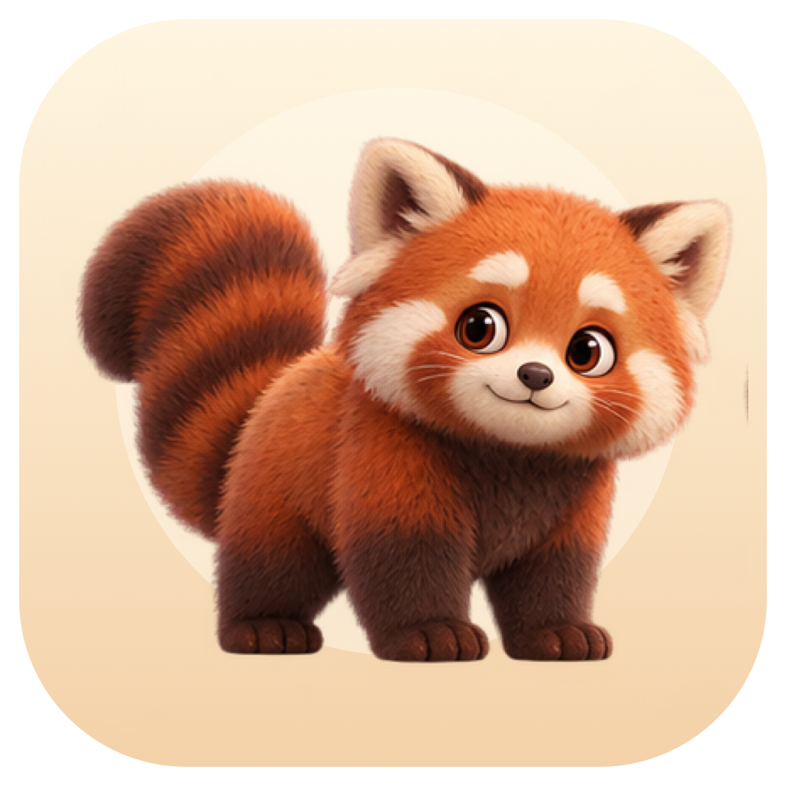
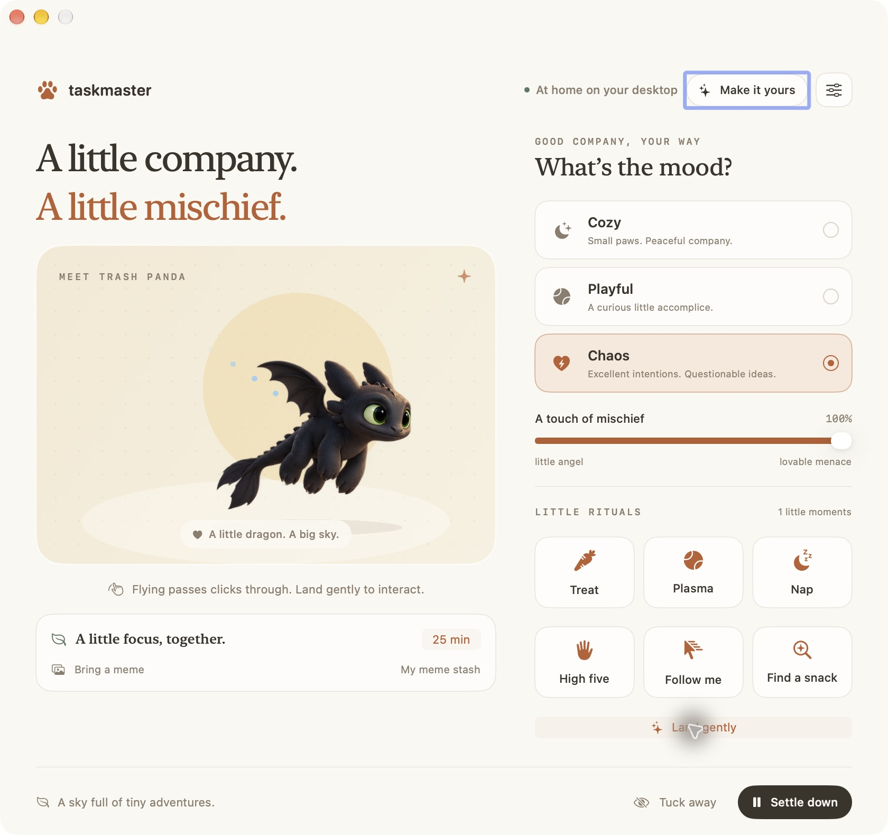
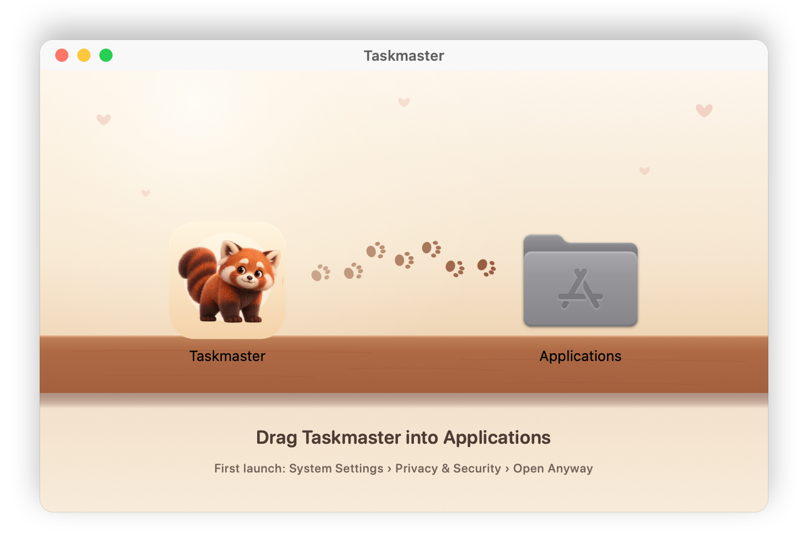
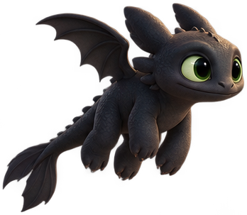
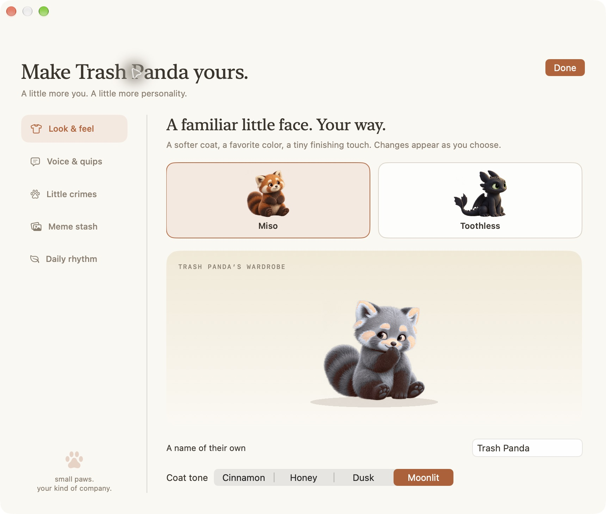

<div align="center">



# Taskmaster

**A little company. A little mischief.**

A desktop companion for your Mac. Miso, a fluffy red panda, wanders along the bottom of your screen,<br>
watches your cursor, naps while you're away, brings you memes and keeps you company while you work.

<a href="https://github.com/ckakkar/taskmaster/releases/latest/download/Taskmaster.dmg"></a>

<sub>Universal (Apple Silicon and Intel) · macOS 14 or later · updates itself</sub>

[](https://github.com/ckakkar/taskmaster/releases/latest)
[](https://github.com/ckakkar/taskmaster/actions/workflows/check.yml)
[](#build-from-source)

[Install](#install) · [Meet your desk mates](#meet-your-desk-mates) · [Things to do together](#things-to-do-together) · [Considerate by design](#considerate-by-design) · [Build from source](#build-from-source)

<br>



</div>

## Install

1. **[Download Taskmaster.dmg](https://github.com/ckakkar/taskmaster/releases/latest/download/Taskmaster.dmg)** and open it.
2. Drag **Taskmaster** into **Applications**.
3. Open it. The first time, macOS stops it because the app isn't notarized: go to **System Settings › Privacy &
   Security** and click **Open Anyway**. You only do this once.

Then say hello, and look for the paw in your menu bar.

<p align="center"></p>

**It keeps itself up to date.** Taskmaster checks for a new release soon after it opens and then every hour. When one
is waiting, a dot appears on the menu bar paw and an **Update ready** note in the companion room; click either to
see what's new, and it installs and relaunches. Switch automatic checks off in the room's settings (the sliders
button) if you'd rather check yourself.

## Meet your desk mates

<table>
  <tr>
    <td align="center" width="50%">
      <br>
      <b>Miso</b><br>
      <sub>A fluffy red panda with curious eyes, a swishing tail and questionable intentions. Muddy zoomies,
      pawprint trails, four coat tones and a tiny wardrobe.</sub>
    </td>
    <td align="center" width="50%">
      <br>
      <b>Toothless</b><br>
      <sub>A miniature Night Fury with bright green eyes and ear fins. Little flights across your screen, blue
      spark trails, a glowing plasma toy, and following your cursor through the air.</sub>
    </td>
  </tr>
</table>

Each companion has ten painted poses and a soft procedural rig: planted footsteps, a breathing chest, a swishing
tail, ear flicks, eyes that follow your cursor, and blinks. Miso is an original character; Toothless is a fan-made
take on the dragon from *How to Train Your Dragon*.

## Things to do together

- **Pet, treat and play.** Stroke gently over the fur for hearts, offer a treat, or throw a ball and watch it get
  chased and batted around.
- **Pick up and put down.** Drag your companion anywhere, let go, and it falls and lands with a little squash.
- **A companion that notices you.** A nearby cursor gets a glance and a head tilt; a wiggling one is an invitation
  to play. Step away for a while and it curls up for a nap.
- **Tiny games.** Offer a high five and click the raised paw. **Follow me** turns your cursor into a leader for a
  minute; **Find a snack** sends it sniffing for a biscuit. Stretches, too, and **Come to this screen** when it's
  on another display.
- **Three moods.** **Cozy**, **Playful** or **Chaos**, plus a mischief slider from little angel to lovable menace.
- **Little crimes.** Chaos leaves temporary muddy pawprints and silly notes. If you invite it, it can even borrow
  your cursor for a second-and-a-half getaway; that's off by default, and a click or Esc ends it.
- **Special deliveries.** Your companion walks off-screen and comes back pulling a card: one of your own images, a
  direct HTTPS image link, or a starter card. Keep it a little longer, send it home, or let deliveries arrive on
  their own every so often.
- **Focus, together.** Start a 1–90 minute session; your companion settles down beside you, then suggests a stretch
  when time's up.
- **Make it yours.** A name, a size, your own sayings (use `{name}` for theirs), cozy or chaotic quip packs, bubble
  colours, Miso's coat tones and a bandana, bow or bell.

<p align="center"></p>

**Finding your way around.** The paw in the menu bar opens the companion room, customization, games, pause, hide
and quit; right-click your companion for the same. Closing the room leaves your companion on the desktop. With
Taskmaster focused, `⌘,` opens the room and `⌘;` opens customization.

## Considerate by design

- **Out of your way.** Clicks pass through everywhere except your companion and its props, it never takes keyboard
  focus, and a flying companion lets every click through.
- **Light on your Mac.** It redraws at 60 fps only while something moves or your pointer is near; calm moments drop
  to 30 fps and naps to 20, and the overlay covers just a strip along the bottom of the screen unless something is
  up high. Rendering stops while your display sleeps.
- **Gentle.** Sound starts off. Reduce Motion turns off the warping, bounces, particles and cursor games.
- **Private.** No account, analytics, cloud, camera or microphone. Your settings and images stay in
  `~/Library/Application Support/Taskmaster/`. Taskmaster only goes online to fetch an image link you paste and to
  check GitHub for updates. It never types, reads your screen or touches your documents.

## Build from source

You need macOS 14 or later, Swift 6 and Xcode or the Xcode Command Line Tools. The only package dependency is
[Sparkle](https://sparkle-project.org), for updates.

```sh
git clone https://github.com/ckakkar/taskmaster.git
cd taskmaster
make run
```

| Command | What it does |
| --- | --- |
| `make run` | Build `Taskmaster.app` and open it (quits a running copy first). |
| `make install` | Build it and copy it into `/Applications`. |
| `make dmg` | The universal app and its drag-to-Applications disk image, in `build/`. |
| `make check` | Behavior and rendering tests, plus a check of every shipped pose. |
| `make lint` · `make format` | Check or apply the Swift formatting. |
| `make measure` | CPU and memory for each companion state, on an optimized build. |

Run `make` for the full list. For a throwaway set of settings while developing, launch the debug build with
`TASKMASTER_STATE_DIR="$PWD/.local" .build/debug/Taskmaster`.

Every push to `main` that passes CI becomes a release on its own: GitHub Actions builds the universal app, the disk
image and the signed update feed. [RELEASING.md](docs/RELEASING.md) covers versions, keys and signing.

### Under the fur

**SwiftUI** draws the companion room and customization, **AppKit** the menu bar and the transparent window your
companion lives in, and **SpriteKit** the companion itself, with a shader for the eyes and a warp grid for the
head, tail and legs. **CompanionCore** holds all the behavior, games, physics and scheduling, with no UI code, so
it's tested directly.

```text
Sources/CompanionCore/        Behavior, games, preferences, scheduling, physics, frame pacing
Sources/Taskmaster/           The app: rendering, eyes, room, customization, memes, updates
Sources/Taskmaster/Resources/ Character art and its pose, eye and paw metadata
Tests/                        Simulation, rendering and image-import tests
scripts/                      App, icon, disk image and release tools
docs/                         Architecture, art provenance, releases and the latest handoff
```

Before contributing, read [ARCHITECTURE.md](docs/ARCHITECTURE.md), [CHARACTER-ART.md](docs/CHARACTER-ART.md) and
[AGENTS.md](AGENTS.md). What's been verified, and what still needs a human eye, is in [HANDOFF.md](docs/HANDOFF.md).

---

<div align="center"><sub>Small paws. Big opinions. Made for the little moments between your work.</sub></div>
